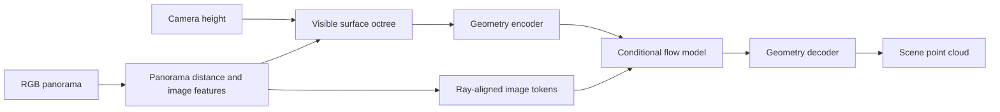

# SpaceFold

**Multiscale 3D Autoencoding for Holistic Panoramic Scene Generation**

SpaceFold represents a room surface as a five-level octree of truncated unsigned distance fields. Its geometry autoencoder compresses the tree into a single **16 × 32 × 32 × 32** latent. A conditional flow model takes a level RGB panorama and a camera height, uses the visible surfaces as anchors, and samples geometry for the entire room. The output is a 3D point cloud in metres.



| Task | Entry point | Requirements |
|---|---|---|
| Build a multiscale tree from surface points or a distance-field envelope | [Geometry guide](docs/geometry.md) · `spacefold-geometry build` or `prepare` | CPU and input geometry |
| Encode a tree or decode a raw scene latent | [Geometry guide](docs/geometry.md) · `spacefold-geometry encode` or `decode` | CUDA, VolFill sparse layers and SpaceFold geometry weights |
| Generate a room from one panorama | [Panorama guide](docs/panorama.md) · `spacefold-infer` | CUDA, both SpaceFold models, matched latent statistics, VolFill and DA² |

**Model availability.** The code accepts tensor-only SpaceFold checkpoints. Public distribution of the two SpaceFold-trained models and their matched statistics is pending rights-holder approval. The geometry preparation commands work directly with user-supplied geometry. [Checkpoint formats and external model](docs/checkpoints.md).

## Installation

Run the following commands from the root of this checkout. To use the CPU geometry tools on macOS or Linux:

```bash
python -m venv .venv
source .venv/bin/activate
python -m pip install -e .
spacefold-geometry --help
```

For full inference, the reference environment is Linux x86-64 with Python 3.10, PyTorch 2.4.1 built for CUDA 12.1, spconv and a BF16-capable NVIDIA GPU. Use a separate environment on the GPU machine:

```bash
conda create -n spacefold python=3.10 -y
conda activate spacefold
python -m pip install --index-url https://download.pytorch.org/whl/cu121 torch==2.4.1 torchvision==0.19.1
python -m pip install -c requirements-cuda121.txt -e '.[inference]'
```

Place the two external source trees in a directory you control. These are the revisions used for validation.

```bash
mkdir -p external
git clone https://github.com/ngoductuanlhp/VolFill.git external/VolFill
git -C external/VolFill checkout --detach a0c8e7779ccee318e7a75bb2d273290d4ffb76ed
git clone https://github.com/EnVision-Research/DA-2.git external/DA-2
git -C external/DA-2 checkout --detach d659838585f2bc9967c7e9367af573795271dbbb
```

## Run a panorama

Obtain the model files described in the [checkpoint guide](docs/checkpoints.md). Supply a level, 2:1 equirectangular image. To try a real warehouse interior, the optional example fetches a checksummed photograph directly from its publisher. [Empty Warehouse 01 by Sergej Majboroda, Poly Haven](https://polyhaven.com/a/empty_warehouse_01).

```bash
python examples/fetch_panorama.py examples/downloads/warehouse.jpg
spacefold-infer \
  --panorama examples/downloads/warehouse.jpg \
  --camera-height 1.6 \
  --dit-checkpoint weights/spacefold-panorama.safetensors \
  --vae-checkpoint weights/spacefold-geometry.safetensors \
  --latent-stats weights/latent_stats.npz \
  --da2-root external/DA-2 \
  --da2-checkpoint weights/da2.safetensors \
  --volfill-root external/VolFill \
  --steps 50 --guidance 3 --seed 0 \
  --output outputs/warehouse
```

The example assumes a 1.6 m camera height. For a new image, use the measured camera-to-floor height when available. The accepted range is 0.5–3.0 m. Choose a fresh output directory.

Open `generated_geometry.ply` in a point-cloud viewer. `prediction_points.npz` stores float32 XYZ positions in metres and the scene bounds. The axes point right, forward and up. `scene.json` records the input hash, camera height, sampling settings and point count. The [panorama guide](docs/panorama.md) describes the intermediate distance field, visible octree, geometry latents and the API for sampling from compatible precomputed conditions.

## Sources and licensing

The SpaceFold source licence is pending confirmation by the project rights holders. External code, model parameters and optional example media have their own terms. The trained SpaceFold parameters, research datasets and original experiment infrastructure are separate from this source tree. [Third-party sources and terms](THIRD_PARTY.md).
